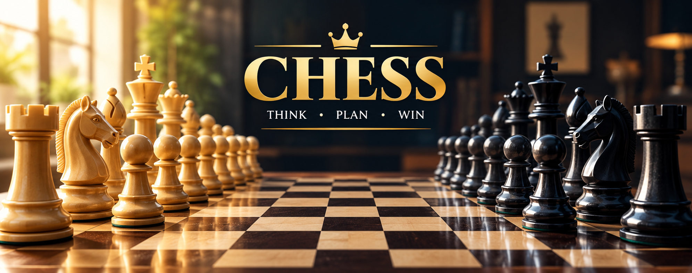

# ♟️ Chess Game

A chess game project built for an enjoyable strategic gaming experience.

## 🎮 Features

- ♟️ Classic chess gameplay
- 👑 All standard chess pieces
- ♜ Strategic two-player matches
- 🎨 Clean, responsive interface

## 🚀 Getting Started

1. Clone or download this repository.
2. Make sure `chess-banner.png` is in the project folder.
3. Open the project's `index.html` file in your browser.

## 🛠️ Technologies

- HTML
- CSS
- JavaScript

## 📸 Preview

The banner above showcases the chess game's visual theme.

## 📄 License

Add your preferred license here.

---

**Think • Plan • Win** ♟️
